# One-Day Hardware: Mini Handheld

**My goal was to design a handheld with a display and buttons in one day, including the PCB, enclosure, and firmware.**

I settled on a little handheld that plays Snake. By the end of the day, I'd routed the board, designed the case, and run the firmware in an emulator. I'd also ordered assembled boards from JLCPCB and parts from other vendors, and started printing the case and a PCB fit model.

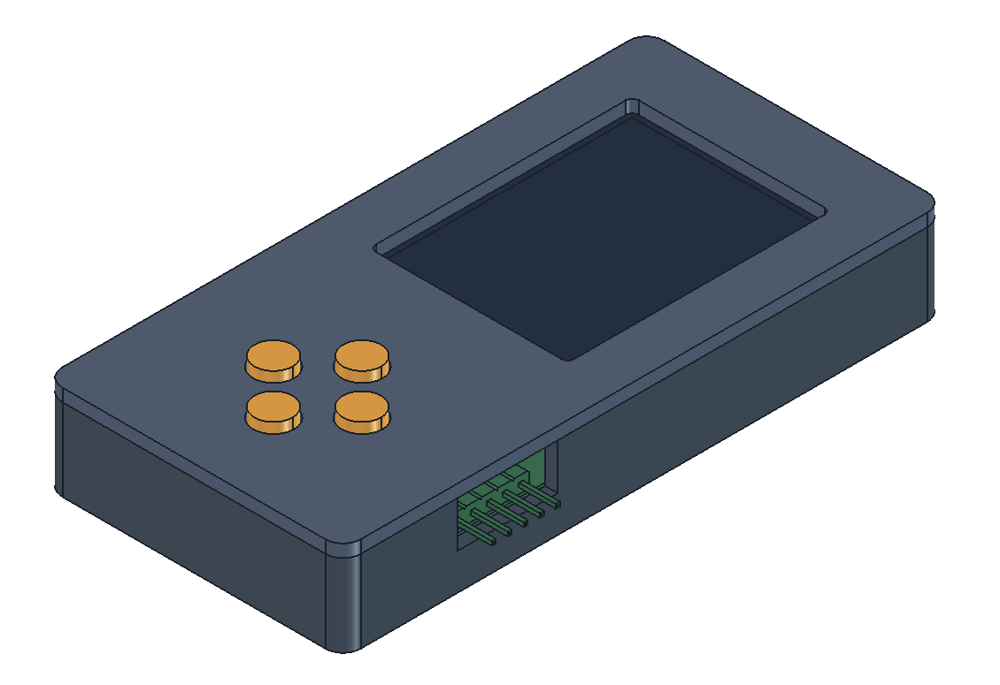

## Tools

- KiCad 10.0 with the [JLCPCB Tools plugin](https://github.com/Bouni/kicad-jlcpcb-tools)
- FreeCAD 1.1.3
- Bambu Lab A1 3D printer and Bambu Studio
- Codex GPT-6.1 sol

## Try it while the boards are in the mail

**[Play Snake in your browser](https://ruben-lohberg.github.io/One-Day-Hardware---Mini-Handheld/)**. Press an arrow key or tap the on-screen D-pad to start. The demo runs the same Snake code compiled to WebAssembly and models how the TFT receives pixels over SPI.

Renode is an emulator that runs the compiled STM32 firmware on a virtual version of the handheld, with simulated buttons and a display.

To try it, run this from the repo on Windows with Python 3, LLVM, and Renode installed.

```powershell
.\firmware\run-web.ps1
```

Open [localhost:8765](http://127.0.0.1:8765/). The browser sends button presses to Renode and shows the pixels written by the STM32 firmware. See the [firmware notes](firmware/README.md#play-snake-in-the-browser) for the mock's timing assumptions and how to run it locally.

## 1. Major component decisions

I knew I wanted JLCPCB to assemble the boards so I wouldn't have to solder all the small parts by hand. I compared microcontroller prices on JLCPCB and display prices on LCSC to find an affordable pair with enough memory for the game and a screen I could drive over SPI. Codex GPT-6.1 sol helped me compare the parts and check the pinouts and flex drawings.

- **STM32G070CBT6.** This is a 48-pin Arm Cortex-M0+ with up to 64 MHz clock speed, 128 KB of flash and 36 KB of RAM. It had enough memory for Snake and enough pins for the buttons, LEDs, SPI display and SWD. JLCPCB could fit it as part of the assembly order. [ST specifications](https://www.st.com/en/microcontrollers-microprocessors/stm32g070cb.html) · [JLCPCB C529338](https://jlcpcb.com/partdetail/STM32G070CBT6/C529338)
- **HS20HS072RX.** This is a 240 × 320 color TFT with a roughly 2-inch diagonal, an ST7789-family controller, a four-wire SPI interface and a 12-pin flex. It was small enough for the handheld and let me send pixel updates straight to the display without keeping a full screen buffer in the STM32's RAM. I could order the display separately and have JLCPCB fit the flex socket. [LCSC C5329582](https://www.lcsc.com/product-detail/C5329582.html) · [Display datasheet](https://datasheet.lcsc.com/datasheet/pdf/75d064ee0eeae326e605dda9d4b98e7e.pdf?productCode=C5329582)

## 2. KiCad schematic

I used USB-C for 5 V power and left the USB data lines unused. I brought out target voltage sense, ground, SWDIO, SWCLK, and reset to a five-pin header for the J-Link. With the STM32G070, four switches with pull-ups, and two red LEDs, I had something simple to test before asking the screen to do anything.

I used SPI for pixels, a GPIO for data/command and a PWM output for the backlight. I changed the logic rail from 3.3 V to 3.0 V to give the display supply more headroom and left the backlight on the USB rail. Codex GPT-6.1 sol helped cross-check the symbol pins and footprints against the drawings and run KiCad's electrical rule check.

[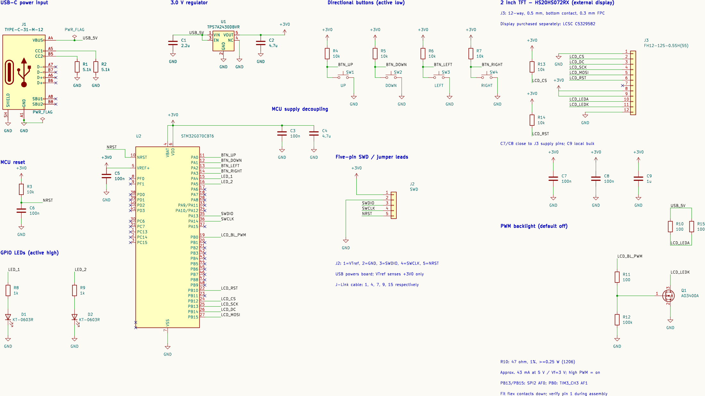](docs/images/kicad-schematic.png)

The [KiCad project](mini_handheld/mini_handheld.kicad_pro) and [design notes](docs/design-notes.md) have the pinouts, part numbers and SWD wiring.

## 3. KiCad board

I chose surface-mount parts wherever I could and kept them on one side so JLCPCB could populate them in a single SMT assembly pass. That kept assembly costs down and left me two connectors to solder by hand. The right-angle SWD header is the through-hole exception, and the USB-C receptacle has surface-mount contacts and through-hole shell anchors.

My first outline was 60 × 95 mm. The display didn't need a board behind all of it, so I let the case carry the glass. That took the PCB down to **42 × 56 mm**. The display flex folds back under the panel into a bottom-contact socket. USB comes out on the left, SWD on the right, and the buttons stay in a cross below the display.

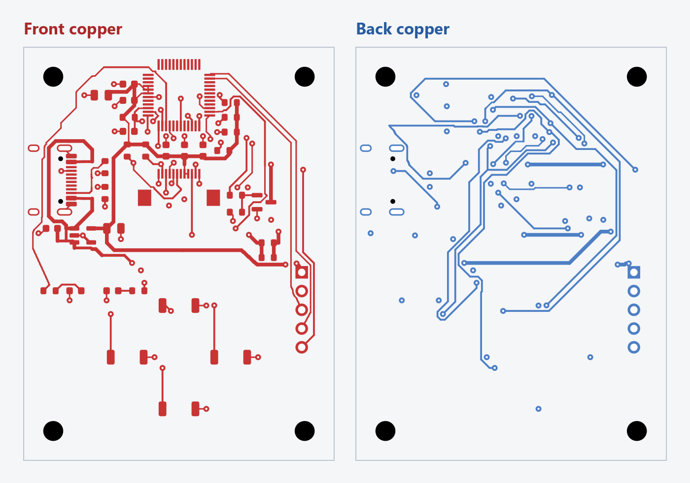

Both views use the same orientation so I can follow a trace through a via from one layer to the other. I hid the ground pours and silkscreen here to make the traces easier to follow.

On this board, the shortest trace wasn't always the one I wanted. I kept the display clock short while routing more of it over ground on the opposite layer. I also increased the spacing between the long SWD traces. Codex GPT-6.1 sol helped compare route lengths and ground coverage. KiCad found **zero ERC violations, zero board DRC violations, and zero unrouted connections**. The schematic parity check flagged the four mounting holes, which exist only on the PCB.

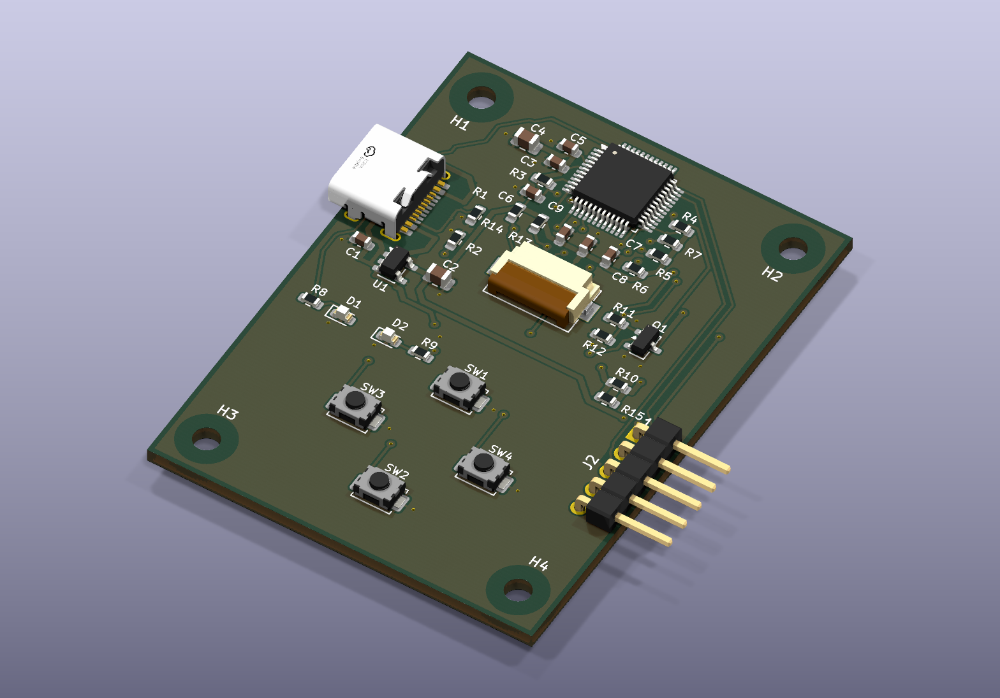

Here are the [placement](docs/placement-review.md) and [routing](docs/routing-review.md) notes, including what the ground coverage check can tell me.

## 4. Electrical simulations

I wanted to see what the rail would do if USB sagged at the same time the load stepped up. With the USB source at 4.4 V and a simulated 25 → 75 mA load step, the 3.0 V rail dropped to **2.979 V** in the nominal case and **2.929 V** in the stress case. The deeper dip farther right is a separate input fault I added on purpose.

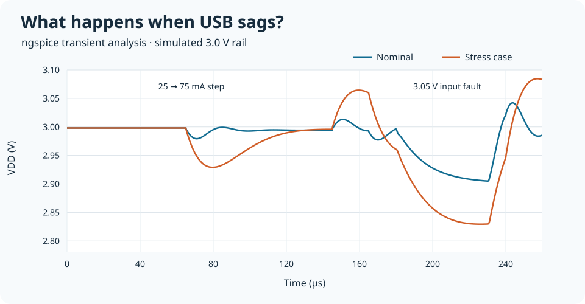

Codex GPT-6.1 sol helped write the SPICE decks and compare display clock edges using ST's IBIS output models. I chose medium GPIO slew and 2 MHz SPI for the first firmware. Since the regulator and flex models are approximate, I'll measure the rail voltage and SPI clock with the screen connected. The assumptions and measurement points are in the [simulation instructions](sim/README.md) and [bring-up notes](docs/hardware-bringup-audit.md).

## 5. Emulation and firmware development

I started with the four buttons and two LEDs, then added a display diagnostic before moving on to Snake. Renode runs the compiled Cortex-M0+ firmware, and the virtual display turns its SPI writes into RGB565 pixels. The on-screen D-pad drives the same active-low GPIO inputs as the physical switches.

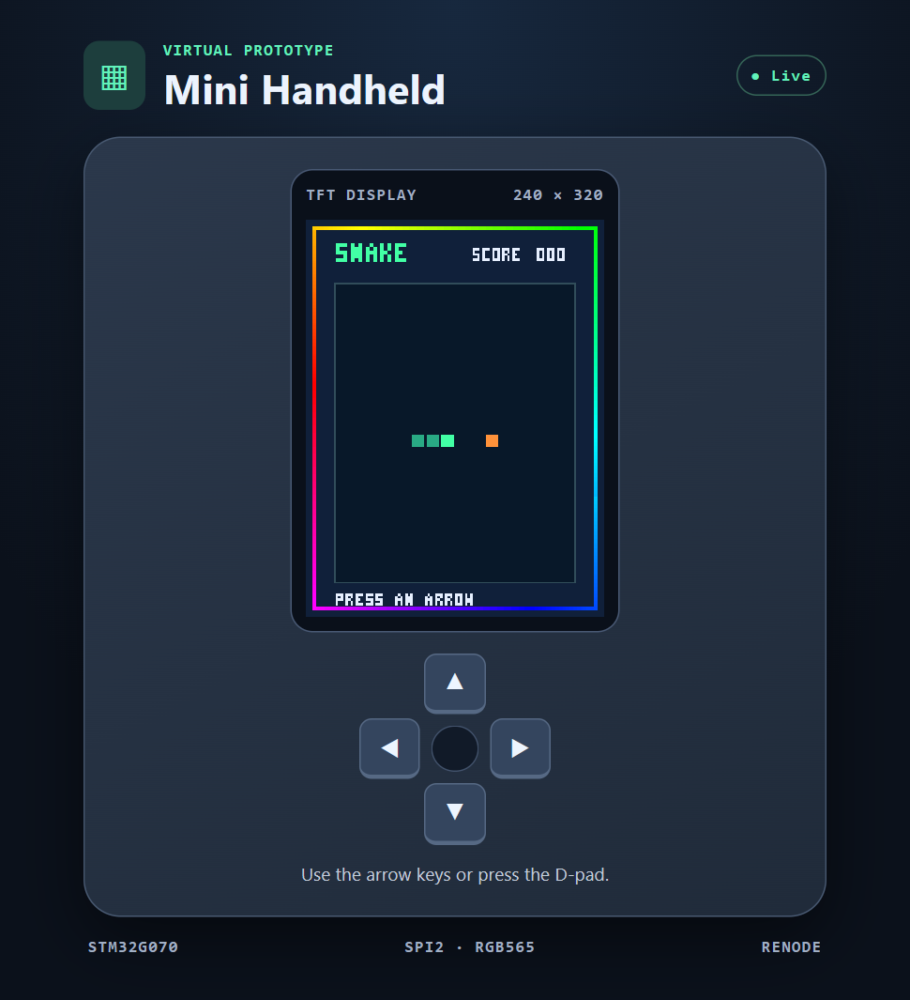

I added an animated rainbow border to show the display's color range and make refresh speed easier to see. The firmware cycles through RGB565 colors and aims to redraw the border about 30 times a second over the 2 MHz SPI link.

Codex GPT-6.1 sol helped with the STM32 code, Renode's SPI and display models, and the test scripts. The tests cover the buttons and LEDs, display updates, steering, growth, scoring, wall collisions and retry. I also checked that the model catches an early chip-select release and a missing PB15 setup bit. The [firmware notes](firmware/README.md) show how to run the checks.

## 6. FreeCAD enclosure

I exported a STEP file from KiCad and opened it in FreeCAD. I especially wanted to see how the flex cable would fold. It needs to reach the socket without getting pinched by the lid, and the display needs to clear the components below it. The case supports the display on ledges and holds the PCB on four standoffs.

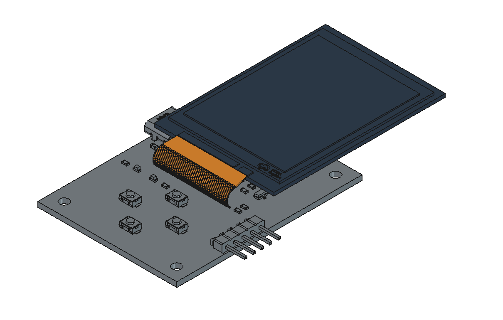

Here's the full board with the display in place. The inset shows how the orange flex folds back under the panel and enters the Hirose socket. I made the socket translucent in FreeCAD so you can see where the end of the flex sits.

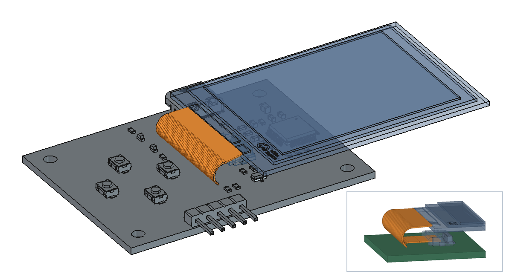

The case measures **47.2 × 95.2 × 15.0 mm**, excluding the buttons. It has a tray, a bezel, and four individual plungers. A lip on each plunger keeps it in the bezel while the case is closed. Codex GPT-6.1 sol helped me script the geometry and check the clearances with the buttons released and pressed.

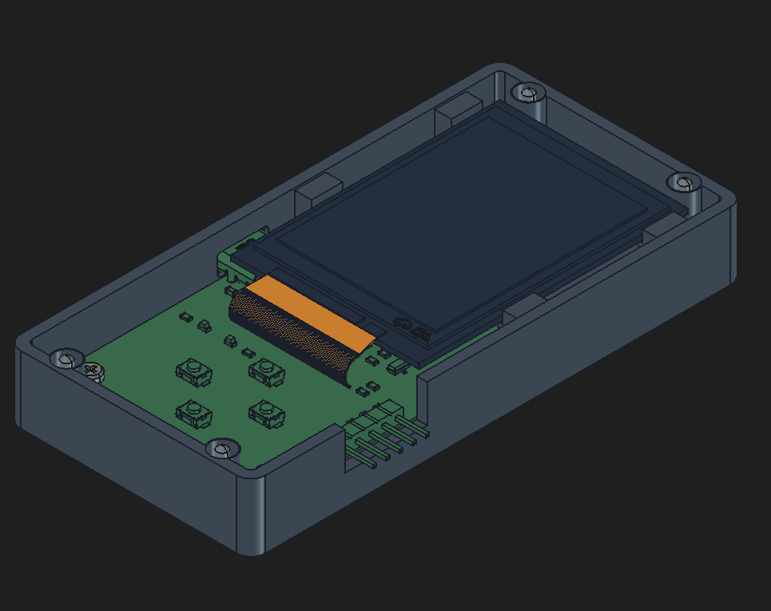

The [FreeCAD model](mechanical/enclosure/enclosure.FCStd), [assembly notes and STLs](mechanical/enclosure/README.md) and [STEP export workflow](mechanical/README.md) are in the repo.

## 7. Order board and parts

I ordered five boards from JLCPCB with the small surface-mount parts and flex socket fitted. I'll solder the USB-C receptacle and SWD header myself, then plug in the display I ordered separately. Codex GPT-6.1 sol helped compare part and feeder costs and check the MOSFET and regulator rotations in the placement file. See the [fabrication ZIP, BOM, and placement file](manufacturing/jlcpcb/) and the [separate parts list](docs/separate-parts.md).

## 8. 3D print prototype

I started printing the enclosure and a PCB fit model while waiting for the parts. The fit model gives me the board outline, mounting holes and connector envelopes so I can check the tray and ports without risking a real board.

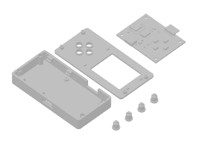

This is the saved slicer preview of the fit-print arrangement. Use the [current STLs](mechanical/enclosure/README.md) when preparing a new print.

I printed the tray, bezel, four button plungers, and stand-ins for the PCB and screen.

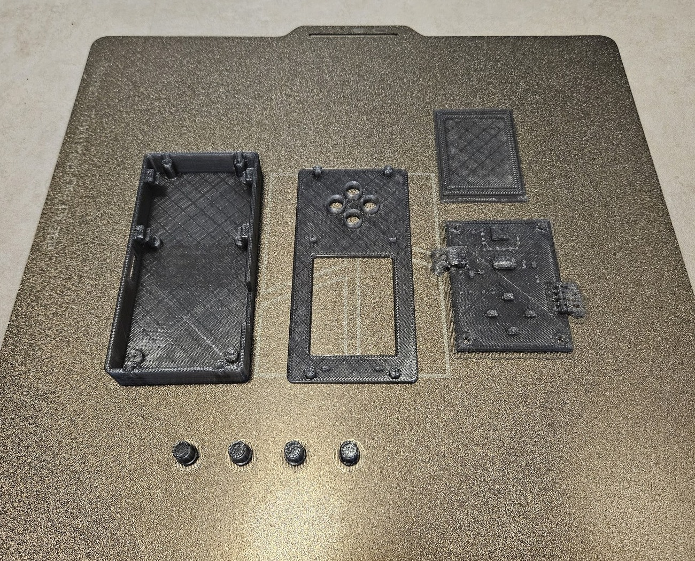

I dropped the printed PCB and screen into the tray. With the bezel beside it, I can see where the board sits and how the screen lines up with the window.

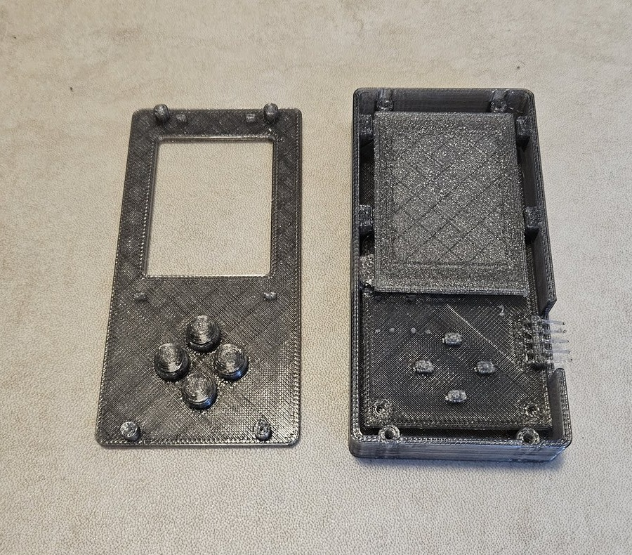

Here it is with the bezel on and all four buttons in place. From the side you can see where the connector opening lands.

<p>
  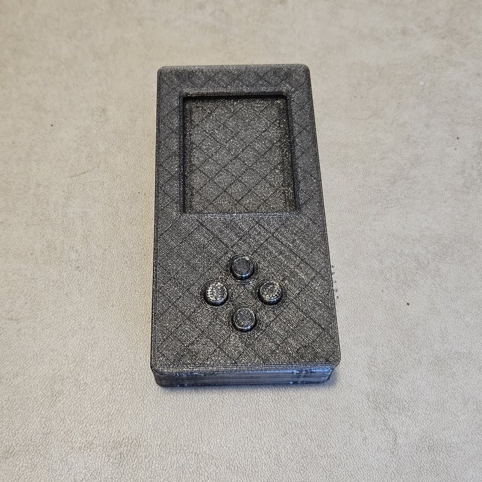
  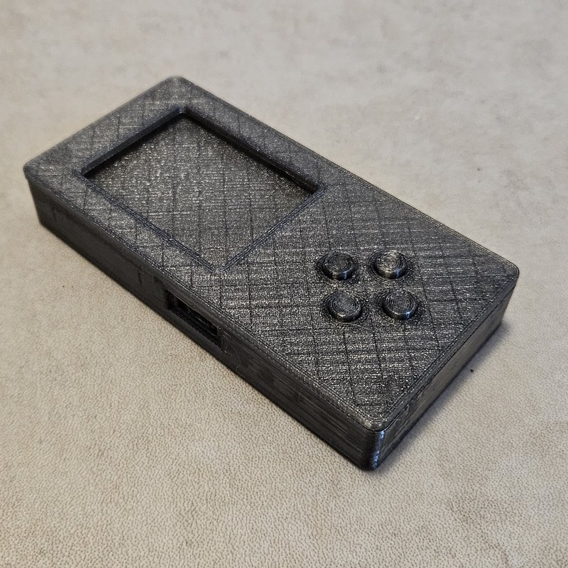
  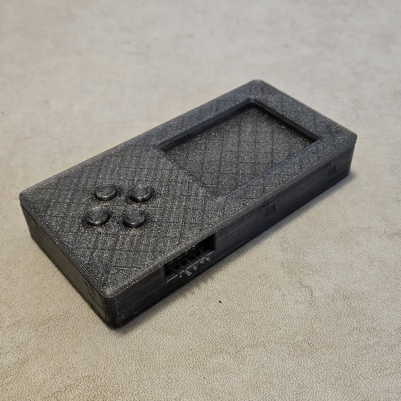
</p>

Once the parts are here, I'll add photos of the delivered boards and first assembly. On the bench I'll check for shorts, measure the 3.0 V rail, connect J-Link and run the button/LED and screen diagnostics before trying Snake. I still need to check the flex latch, USB plug clearance and switch travel on real parts.
